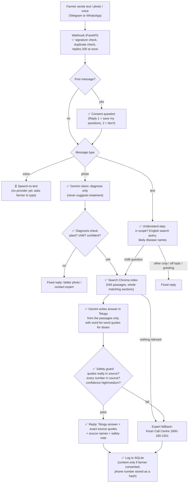
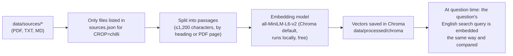

# Farmer Assistant: project status

_Last updated: 24 November 2026. Phase 1 (MVP). See [CLAUDE.md](CLAUDE.md) for scope and the safety rules._

A WhatsApp/Telegram advisor for **chilli** farmers around **Paluvai / Rentachintala, Palnadu district, Andhra Pradesh**. It answers in **Telugu**, using only vetted agricultural documents, and sends the farmer to an expert whenever an answer can't be verified.

---

## 1. At a glance

| Area | Status | Notes |
|---|---|---|
| Backend code (Phase 1) | ✅ Built | Webhooks, message pipeline, search, safety checks, logging. 47 automated tests pass |
| AI model | ✅ Working | Gemini `gemini-2.5-flash` (free tier: 20 requests/day). Claude also supported |
| Documents (chilli) | 🟡 Good start | 7 documents, 545 searchable passages; 25 of 30 common topics covered |
| Converting documents to embeddings | ✅ Done automatically | Happens during `scripts/ingest.py`; see [section 5](#5-embeddings-already-done) |
| Expert review of documents | ❌ Not started | `reviewed_by` is empty for every source |
| Test questions (evaluation set) | ❌ Empty | `data/eval/questions.jsonl` has 0 questions |
| Telegram test bot | ⏳ Code ready, not set up | Needs a bot token from @BotFather |
| WhatsApp | ⏳ Code ready, not set up | Needs a Meta WhatsApp Business account |
| Voice notes (speech) | ❌ Provider not chosen | Bot replies "please type" for now |
| Telugu fixed messages | ❌ English only | Must be written or checked by a native speaker |
| Photo diagnosis | ✅ Code ready, ⏳ not tested on real field photos | |

---

## 2. How a farmer's message flows today



✅ = built and tested ⏳ = waiting on a setup step or decision

---

## 3. Code: what is built

All Phase 1 code from [CLAUDE.md](CLAUDE.md) section 6 exists, about 2,600 lines including tests.

| Part | File(s) | What it does | State |
|---|---|---|---|
| Settings | `app/config.py`, `.env` | Crop, region, language, keys, thresholds | ✅ |
| Webhooks | `app/main.py` | Telegram and WhatsApp endpoints, signature checks, duplicate filtering, background processing | ✅ tested with fakes |
| Message flow | `app/pipeline.py` | Consent, voice, photo, text, search, answer, safety, logging | ✅ |
| AI model clients | `app/llm/client.py` | Gemini (default) and Claude behind one interface; retries on overload; falls back to expert on errors and refusals | ✅ live-tested with Gemini |
| Prompts and output formats | `app/llm/prompts.py`, `app/llm/schemas.py` | Structured JSON for every step; rules: sources only, verbatim doses, IPM first, don't translate plant/product names | ✅ |
| Photo diagnosis | `app/vision/detector.py` | Diagnosis only, with confidence | ✅ code, ⏳ no real-photo test |
| Document loading | `app/rag/ingest.py` | Only files listed in `sources.json`; per-crop filter; `## ` headings; skips listed PDF pages | ✅ |
| Search | `app/rag/retriever.py` | Chroma vector search, several queries merged, returns whole matching sections | ✅ |
| Safety guard | `app/safety/guard.py` | Checks quotes are word-for-word in the source and every number appears in a cited source | ✅ 14 tests |
| Fixed messages | `app/ui_text.py` | Consent, fallbacks, safety note (never written by the AI) | ✅ English, ❌ Telugu |
| Storage | `app/store.py` | SQLite: consent, duplicates, interaction log (hashed user ids) | ✅ |
| Speech | `app/speech/base.py` | Interface plus a "not configured" provider | ⏳ provider not chosen |
| Messaging | `app/messaging/` | Telegram and WhatsApp Cloud API: receive, download media, send | ✅ code, ⏳ no live account |

**Scripts**

| Script | Purpose |
|---|---|
| `scripts/ingest.py` | Read sources, split into passages, create embeddings, save the index |
| `scripts/ask.py` | Ask a question from the terminal (text or `--image`) |
| `scripts/telegram_polling.py` | Run the bot on Telegram without a public server |
| `scripts/eval.py` | Run the test question set and write a spreadsheet for expert grading |
| `scripts/list_models.py` | List Gemini models the API key can use |
| `scripts/extract_cibrc_crop.py` | Pull chilli rows out of the government's approved-pesticide PDFs |

**Tests:** 47 pass (`pytest`), and lint and format checks pass (`ruff`, `black`). Tests never call real APIs.

---

## 4. Documents collected (chilli)

All documents are in `data/sources/` and recorded in `data/sources/sources.json`. Original downloads are in `data/sources/raw/` and are not indexed. Source files are git-ignored; only `sources.json` is pushed to GitHub.

| # | Document | Publisher | Passages | Notes |
|---|---|---|---|---|
| 1 | CIB&RC approved uses of pesticides on chilli (as on 30.09.2026) | Govt. of India, CIB&RC / PPQS | 220 | 219 approved products with dose per hectare and waiting period. 19 irregular rows skipped, listed in `raw/cibrc_skipped_rows_chilli.txt` for manual check |
| 2 | AESA based IPM – Chillies/Capsicum (Package No. 24) | NIPHM, Hyderabad (with ANGRAU experts) | 143 | Main IPM guide: pests, diseases, crop-stage IPM, nutrient deficiencies, safety. Doses **per acre**. Marked "for internal circulation only" |
| 3 | Vikaspedia: chilli package of practices and IPM | Govt. of India portal (content from ICAR, NIPHM) | 88 | Overlaps a lot with #2 |
| 4 | Monitoring, diagnosis and management of *Thrips parvispinus* in chilli (2022) | PPQS | 42 | Black thrips; includes approved thrips insecticide table |
| 5 | TNAU Agritech: chilli pests and diseases | Tamil Nadu Agricultural University | 35 | 17 pages. Written for Tamil Nadu; some older chemicals (phosalone, methyl demeton) need expert check |
| 6 | Management strategies for invasive thrips (IPM-01/2022) | PPQS | 13 | Text only; its annexure table is an image and not readable |
| 7 | ANGRAU KVK Garikapadu: chilli findings | ANGRAU / ICAR KVK, Krishna district | 4 | AP varieties (LCA-334, 625, 620), NPK 450:90:180 kg/ha. Copied word for word and checked |
| | **Total** | | **545** | |

**Kept out of the index on purpose**
- `raw/ppqs_advisory_on_chilli_thrips.pdf`: scanned, and its dose table came out garbled ("50-600" for "500-600").
- `raw/ppqs_rice_bph_advisory.pdf`, `tnau_rice_diseases.txt`: from the earlier paddy setup, not used for chilli.
- `raw/angrau_kvk_garikapadu_activities.pdf`: the full report mixes crops. Only the chilli passages (#7) are used.

**Could not download** (sites block scripted access or time out): ICAR-IISR chilli GAP (2019) and ICAR-CCARI leaf curl sheet (2022). Both are **not needed**; #2 and #3 cover the same ground.

### Topic coverage (30 common chilli problems searched against the index)

| Result | Topics |
|---|---|
| ✅ Covered (25) | Thrips, black thrips, yellow mite, aphids, whitefly, fruit borer, Spodoptera, mosaic, die-back / fruit rot, powdery mildew, damping off, Fusarium wilt, Cercospora and bacterial leaf spot, Choanephora wet rot, nematodes, NPK fertilizer, micronutrients (Zn, B, Ca), flower drop, seed rate and spacing, irrigation, weed control, harvest and drying, pesticide waiting periods, safe spraying |
| 🟡 Thin (3) | Leaf curl virus (covered only under general viral management), bud necrosis, AP varieties (one ANGRAU passage) |
| ❌ Missing (2) | **Sowing months for AP**, bacterial wilt |

---

## 5. Embeddings: already done

**Converting text to embeddings is already part of `scripts/ingest.py`; no separate step is needed.** What happens when you run it:



- **Model:** `all-MiniLM-L6-v2`, about 80 MB, downloaded once and run on this computer at no cost.
- **Re-run when needed:** run `scripts/ingest.py` again whenever you add, remove or change a document, or change `CROP`. It rebuilds the index from scratch.
- **Why the bot searches in English:** this model understands English only, so the bot turns each Telugu question into an English search query first. The answer is still written in Telugu.

**Possible later improvements (not required for MVP)**
- A multilingual embedding model, so Telugu documents (such as ANGRAU's *Vyavasaya Panchangam*) can be searched directly.
- Tune the similarity threshold (`MIN_SOURCE_SIMILARITY=0.35`) using real test questions.

---

## 6. Decisions made (Phase 0)

| Decision | Value | Status |
|---|---|---|
| Crop | Chilli | ✅ decided |
| Region | Palnadu district, AP (Paluvai / Rentachintala) | ✅ decided |
| Language | Telugu (`te`) | ✅ decided |
| AI provider | Gemini `gemini-2.5-flash` | ✅ (free tier for now) |
| Expert contact in fallbacks | Kisan Call Centre 1800-180-1551 | ⏳ confirm a local contact (mandal agriculture officer / KVK) |
| Speech provider | Bhashini, Sarvam AI or Google Cloud Speech | ❌ not chosen |
| Telugu fixed messages | | ❌ need a native speaker |

---

## 7. What live testing showed

- **Working end to end:** "మిరప ఆకులు పైకి ముడుచుకుంటున్నాయి" ("chilli leaves curling up") → correctly identified **thrips (తామర పురుగు)**. Cultural steps came first, then biological, then chemical, with doses quoted word for word, sources named, and high confidence.
- **Safety fallbacks work:** a cotton question and an unanswerable question were correctly sent to an expert.
- **Bugs found and fixed:**
  - Gemini API version error.
  - Treatment sections not found when the farmer described only symptoms.
  - Large chunks hiding treatment text.
  - Front-matter pages crowding out search results.
  - **A translation error:** *Sesbania grandiflora* was translated as "sesame". The prompt now keeps plant and product names untranslated.
- **Limit:** the Gemini free tier allows 20 requests per day, which is about 10 questions.

---

## 8. What we still have to do

### Before any farmer uses it (required)
- [ ] **Expert review of every document.** An agronomist from ANGRAU (Lam station, Guntur) or the district KVK checks each source and fills in `reviewed_by` / `reviewed_on` in `sources.json`. Includes the 19 skipped CIB&RC rows and the TNAU chemicals.
- [ ] **AP-specific documents:** ANGRAU chilli package of practices or the *Vyavasaya Panchangam* chilli chapter, for sowing months, AP varieties and local doses. Ask at the Lam station or KVK.
- [ ] **Test question set:** 30–50 real Telugu farmer questions in `data/eval/questions.jsonl`, each marked "answer" or "fallback". Run `scripts/eval.py`, and have the expert grade each answer correct, wrong or unsafe. **Any "unsafe" answer blocks launch.**
- [ ] **Telugu fixed messages** in `app/ui_text.py` (consent, fallbacks, safety note), written by a native speaker.
- [ ] **Local expert contact** in `EXPERT_CONTACT`.
- [ ] **Paid Gemini key** (Google AI Studio billing): removes the 20/day limit and keeps farmer data out of Google's free-tier training.

### Getting it into farmers' hands
- [ ] **Telegram test bot:** get a token from @BotFather, put it in `TELEGRAM_BOT_TOKEN`, run `scripts/telegram_polling.py`, and test on your phone.
- [ ] **Photo testing:** 20–30 real chilli photos from Palnadu fields, labelled by the expert, with the farmers' permission.
- [ ] **Choose a speech provider** (Telugu speech-to-text and text-to-speech) and implement it in `app/speech/`.
- [ ] **WhatsApp:** Meta Business account, phone number, webhook on a server (HTTPS), and the `WHATSAPP_*` settings.
- [ ] **Pilot:** 20–30 farmers for two weeks; the expert reviews a sample of logged answers.

### Technical improvements (nice to have)
- [ ] Log the AI's draft answer even when the safety guard blocks it, so the expert can see why.
- [ ] Reduce duplicate passages (Vikaspedia repeats NIPHM) and approved-product entries crowding results.
- [ ] Multilingual embeddings (see section 5).
- [x] Commit and push the NIPHM source, `extract_cibrc_crop.py` and the prompt fix.

### Later phases (not now; see [CLAUDE.md](CLAUDE.md) section 9)
Farmer profiles, weather advice, crop calendar reminders, mandi prices, feedback buttons (Phase 2); more crops and languages, pest outbreak alerts, expert dashboard (Phase 3).

---

## 9. Quick commands

```bash
source .venv/bin/activate
python scripts/ingest.py                      # rebuild the index after changing documents
python scripts/ask.py "మిరప ఆకులు పైకి ముడుచుకుంటున్నాయి"   # ask a question
python scripts/eval.py                        # run the test question set
pytest                                        # run all tests
```

## 10. History

| Commit | What |
|---|---|
| `ba2bd66` | Phase 1 MVP scaffold |
| `7f92b12` | Gemini added as default AI provider |
| `37127bb` | Gemini fixes (API version, retries, model) |
| `83ae18f` | Switched to chilli in Palnadu; better search for real documents |
| (this commit) | NIPHM package, CIB&RC approved-uses extraction, ANGRAU excerpts, translation fix, this file |
